# CineMind — Project Structure & Internal Architecture

> A code-accurate walkthrough of how CineMind works, from process startup to the pixels a
> user sees. Every workflow below was traced through the actual source in this repository.

---

## 1. Introduction

This document explains **how CineMind works internally**, not just how its folders are laid
out. It traces real function calls, data transformations, request/response schemas, and
error/fallback branches through the actual source files.

**How to navigate it:**

| If you want to understand… | Read |
|---|---|
| What each file is for | [Section 2 — Directory Tree](#2-actual-project-directory-tree) |
| The whole system on one page | [Section 3 — End-to-End Workflow](#3-complete-end-to-end-cinemind-system-workflow) |
| What happens when the server boots | [Section 4 — Startup & Initialization](#4-application-startup-and-initialization-workflow) |
| `POST /recommend` | [Section 5 — Movie Recommendation](#5-movie-recommendation-workflow) |
| `POST /ai-discovery` | [Section 6 — AI Discovery](#6-ai-discovery-workflow) |
| `POST /chat` and Groq | [Sections 7–8 — Chatbot](#7-chatbot-workflow) |
| The embedding/FAISS mechanics | [Section 9 — Semantic Search & FAISS](#9-semantic-search-and-faiss-workflow) |
| How raw rows become cards | [Section 10 — Result Generation & Display](#10-result-generation-and-display-workflow) |
| Watchlist / preferences / history | [Section 11 — Persistent Storage](#11-persistent-storage-workflow) |
| Route-by-route API contract | [Section 12 — API & Frontend Communication](#12-api-and-frontend-communication) |
| The `.npy` / `.bin` / `.csv` files | [Section 13 — Data & Model Artifacts](#13-data-and-model-artifacts) |
| Every failure branch | [Section 14 — Error Handling & Fallbacks](#14-error-handling-and-fallback-workflows) |
| The test suite | [Section 15 — Tests & Verification](#15-tests-and-verification) |
| "Where is this in the code?" | [Section 16 — How to Trace a Request](#16-how-to-trace-a-request-in-source-code) |

**Document conventions**

- ✅ **Verified** — behaviour confirmed by reading the source (and, where noted, by running it).
- ⚠️ **Unverified / environment-dependent** — behaviour depends on installed packages or config
  that cannot be assumed. These are called out explicitly.
- Function names are written as `module.function()` and link to their file.
- All Mermaid diagrams use standard GitHub-supported syntax.

**Related docs:** see [`README.md`](README.md) for setup, install, configuration, the API
reference, module reference and troubleshooting.

> **Local-first principle (verified):** every movie title, poster, score and home-page row
> originates from local files under `models/`. The **only** outbound AI call is the optional
> chatbot, which phrases a reply around results the local engine already produced. The chatbot
> is never the retrieval engine.

---

## 2. Actual Project Directory Tree

Tree generated from the working copy. Runtime/user data (`data/`), the virtual environment
(`.venv/`), caches (`__pycache__/`) and secrets (`.env`) are **not** shown as tracked content;
their purpose is still explained below. Large model artifacts are present on disk but are
git-ignored (see `.gitignore`).

```
ML Projects - ADV/                      (repository root — the "project root")
├── backend/                            FastAPI application + all server logic
│   ├── __init__.py                     Marks the package; empty
│   ├── app.py                          FastAPI app, routing, request models, static mounts
│   ├── recommendation_engine.py        Loads artifacts once; FAISS search, ranking, discovery
│   ├── chatbot.py                      Intent parsing + orchestration of local engine + AI reply
│   ├── llm.py                          Centralized Groq client, config and error mapping
│   ├── watchlist.py                    Watchlist persistence (data/watchlist.json)
│   ├── preferences.py                  Like/dislike → derived genres/themes (data/user_preferences.json)
│   ├── insights.py                     Activity log + aggregated stats (data/recommendation_history.json)
│   └── storage.py                      Atomic, cross-process JSON read/write helpers
├── frontend/                           Static single-page UI (no build step)
│   ├── index.html                      Page shell: hero, carousel, rows, RecLab, modals, chat
│   ├── css/
│   │   ├── style.css                   Main styles
│   │   └── responsive.css              Responsive/mobile styles
│   └── js/
│       ├── api.js                      API client (fetch wrapper + one method per route)
│       ├── app.js                      Main application logic / rendering / event wiring
│       ├── utils.js                    Formatting helpers (year, rating, poster, escaping)
│       └── notifications.js            Toast notification toasts
├── models/                             Precomputed ML artifacts (loaded once at startup)
│   ├── movie_metadata.csv              Catalogue: 9,828 rows × 10 columns
│   ├── movie_embeddings.npy            float32 (9828, 384) normalized embeddings
│   └── faiss_index.bin                 Serialized faiss.IndexFlatIP (9,828 vectors, dim 384)
├── notebook/
│   └── CineMind.ipynb                  Offline modelling journey + artifact exporter
├── tests/
│   ├── test_chatbot_groq.py            Groq provider, client lifecycle, chatbot fallbacks
│   └── test_targeted_fixes.py          Sentence-model loading, discovery paths, storage locking
├── data/                               Local JSON "database" written at runtime (git-ignored)
│   ├── watchlist.json                  Saved movies
│   ├── user_preferences.json           Likes/dislikes + derived genres/themes
│   └── recommendation_history.json     Activity log (searches, recs, feedback…)
├── .env                                Local secrets (git-ignored) — NEVER read/committed
├── .env.example                        Documented template with placeholder values
├── .gitignore                          Excludes .env, data/, .venv/, and model artifacts
├── requirements.txt                    Python dependencies
├── README.md                           Setup, usage, API + module reference
└── PROJECT_STRUCTURE.md                This document
```

> `data/` also contains runtime log files (`*.log`, e.g. `server_out.log`, `bg_out.log`). They
> are git-ignored and are not part of the application logic.

### File / directory purposes

| Path | Purpose | Key entry points |
|---|---|---|
| `backend/app.py` | Defines the FastAPI app, CORS, static mounts, Pydantic request models and **all** HTTP routes; delegates work to the other modules. | `app`, `_clean()`, every `@app.get/@app.post` handler |
| `backend/recommendation_engine.py` | Loads the three model artifacts **once at import**; provides FAISS search, personalized ranking, What-If re-ranking, AI Discovery and deterministic explanations. | `get_recommended_movie_details()`, `recommend_personalized()`, `what_if_recommendations()`, `discover_movies()`, `build_reasons()` |
| `backend/chatbot.py` | Orchestration layer for the chatbot. Extracts intent locally, calls the **local engine** for movies, and asks Groq only to word the reply. Also parses natural-language What-If phrases. | `chat()`, `_extract_title()`, `_extract_count()`, `_best_title_match()`, `_ai_summarize()`, `parse_whatif_phrase()` |
| `backend/llm.py` | The single place that creates/configure the Groq client and maps SDK errors to safe messages. Never logs the key. | `chat_completion()`, `is_configured()`, `get_model()`, `provider_status()` |
| `backend/watchlist.py` | Watchlist add/remove/list/check; enriches stored entries with live metadata on read. | `add_to_watchlist()`, `get_watchlist()`, `is_in_watchlist()` |
| `backend/preferences.py` | Records likes/dislikes and re-derives preferred genres/themes from liked movies. | `add_feedback()`, `_recompute_tags()`, `get_preferences()` |
| `backend/insights.py` | Best-effort activity log and aggregated statistics. | `log_event()`, `log_search()`, `log_recommendation()`, `get_insights()` |
| `backend/storage.py` | Atomic JSON I/O with per-file thread locks **and** cross-process file locks. | `load_json()`, `save_json()`, `update_json()`, `_file_lock()` |
| `frontend/index.html` | The single page: hero, carousel, curated rows, Recommendation Lab, modals, chat panel. | section IDs referenced by `app.js` |
| `frontend/js/api.js` | Thin `fetch` wrapper; auto-detects same-origin vs `http://127.0.0.1:8000`; one method per route. | `API.search()`, `API.recommend()`, `API.chat()`, … |
| `frontend/js/app.js` | All rendering, event handling and state. | `App.init()`, `doSearch()`, `showMovieAndRecommend()`, `sendChat()`, `openDiscovery()`, `openWhatIf()` |
| `frontend/js/utils.js` | Pure formatting helpers. | `Utils.poster()`, `Utils.simPercent()`, `Utils.esc()`, `Utils.placeholder()` |
| `frontend/js/notifications.js` | Toast messages. | `Notifications.show()` |
| `models/*` | Precomputed artifacts — the "model". Never regenerated per request. | see [Section 13](#13-data-and-model-artifacts) |
| `notebook/CineMind.ipynb` | Offline training/evaluation and the code that exported the three artifacts. | `np.save`, `faiss.write_index`, `to_csv` |
| `tests/*` | Unit/integration tests (mocks only; no network or key required). | `unittest` |
| `data/*.json` | Local persistence, written at runtime. | see [Section 11](#11-persistent-storage-workflow) |

---

## 3. Complete End-to-End CineMind System Workflow

This is the master diagram. It separates **startup (once)** from **per-request** work and shows
the four user-facing feature families. Read the numbered key below it.

```mermaid
flowchart TD
    subgraph STARTUP["A. Startup (happens ONCE, at import/launch)"]
        S1["python -m backend.app<br/>or uvicorn backend.app:app"] --> S2["backend/app.py is imported"]
        S2 --> S3["recommendation_engine imported"]
        S3 --> S4{"_check_artifacts_exist()<br/>3 files present?"}
        S4 -- No --> S4F["FileNotFoundError<br/>server fails to start"]
        S4 -- Yes --> S5["Load movie_metadata.csv"]
        S5 --> S6["Load movie_embeddings.npy<br/>cast float32"]
        S6 --> S7["faiss.read_index(faiss_index.bin)"]
        S7 --> S8{"Alignment check:<br/>meta rows == emb rows == faiss ntotal?"}
        S8 -- No --> S8F["RuntimeError<br/>server fails to start"]
        S8 -- Yes --> S9["Precompute lowercase columns<br/>+ popularity/rating series"]
        S9 --> S10["Mount /static /css /js<br/>add CORS middleware"]
        S10 --> S11["Resolve HOST/PORT (default 127.0.0.1:8000)"]
        S11 --> S12["uvicorn serves the app"]
    end

    subgraph BROWSER["B. Browser (each visit)"]
        U1["User opens http://127.0.0.1:8000/"] --> U2["GET / → FileResponse index.html"]
        U2 --> U3["app.js App.init()"]
        U3 --> U4["GET /api (hero stats)"]
        U3 --> U5["GET /movies × several sorts"]
    end

    subgraph REQ["C. Per-request pipeline (every API call)"]
        R1["frontend/js/api.js _fetch()"] --> R2["FastAPI route handler in app.py"]
        R2 --> R3["Pydantic validation of body/query"]
        R3 -- invalid --> R4["HTTP 400/404/500 JSON detail"]
        R3 -- valid --> R5["Dispatch to feature module"]
        R5 --> R6["Perform local data/model work"]
        R6 --> R7["_clean() NaN/numpy → JSON"]
        R7 --> R8["JSONResponse to browser"]
        R8 --> R9["app.js renders HTML"]
        R4 --> R9
    end

    STARTUP -.->|"engine ready"| REQ
    BROWSER --> REQ

    REQ --> F1["FEATURE: Search & Recommend<br/>GET /search → POST /recommend"]
    REQ --> F2["FEATURE: AI Discovery<br/>POST /ai-discovery"]
    REQ --> F3["FEATURE: Chatbot<br/>POST /chat (+ optional Groq)"]
    REQ --> F4["FEATURE: Persistent user tools<br/>watchlist / preferences / insights"]

    F1 --> G["Results displayed in UI"]
    F2 --> G
    F3 --> G
    F4 --> G
```

### Step-by-step explanation

**A. Startup (once)**

1. The process is launched with `python -m backend.app` or `uvicorn backend.app:app`.
   The `__main__` block in `backend/app.py` reads `HOST`/`PORT` (defaults `127.0.0.1:8000`)
   and calls `uvicorn.run(..., reload=True)`.
2. Importing `backend/app.py` triggers `from . import recommendation_engine as engine`
   (`backend/app.py:31`). Because the engine module runs code at *import time*, all artifact
   loading happens here — once per process.
3. `_check_artifacts_exist()` (`recommendation_engine.py:77`) verifies all three files exist,
   otherwise raises `FileNotFoundError` and the server cannot start.
4. `pandas.read_csv` loads `movie_metadata.csv`; a `movie_id` column is synthesized from the
   index if missing; only the documented columns are kept.
5. `numpy.load` loads `movie_embeddings.npy` and casts to `float32` if needed.
6. `faiss.read_index` loads `faiss_index.bin`.
7. The **alignment check** (`recommendation_engine.py:122–134`) asserts
   `len(metadata) == embeddings.shape[0] == index.ntotal`; on mismatch it raises `RuntimeError`.
8. Lowercase helper columns (`_title_lower`, `_overview_lower`, `_genre_lower`, `_popularity`,
   `_rating`) are precomputed for the AI-Discovery fallback.
9. `backend/app.py` mounts the frontend as static (`/static`, `/css`, `/js`) and enables CORS.
10. `uvicorn` begins serving.
    - ⚠️ `backend/chatbot.py` prints a warning at import if the `groq` SDK or `GROQ_API_KEY` is
      missing, but this **does not** stop startup.
    - ⚠️ The Sentence Transformer model is **not** loaded at startup (lazy load — see Section 6).

**B. Browser (each visit)**

11. `GET /` returns `frontend/index.html` directly (`app.py:146`).
12. `app.js` `App.init()` wires events, loads hero stats with `GET /api`, and loads the home rows
    with several `GET /movies` calls.

**C. Per-request pipeline (every API call)**

13. `frontend/js/api.js` `_fetch()` resolves the base URL (same-origin first, else
    `http://127.0.0.1:8000`), sends the request, and raises on non-2xx with the backend's
    `detail` message.
14. The matching FastAPI handler in `app.py` validates input via Pydantic (and explicit checks
    such as `n` ranges).
15. Valid requests dispatch to a module (`recommendation_engine`, `chatbot`, `watchlist`, …).
16. The module performs local work; the result passes through `_clean()` to convert
    `NaN`/numpy types into JSON-safe values.
17. The browser receives JSON and `app.js` renders it.

**Feature families:** Search/Recommend (F1), AI Discovery (F2), Chatbot (F3), and the persistent
user tools (F4). Each has its own detailed workflow in later sections.

---

## 4. Application Startup and Initialization Workflow

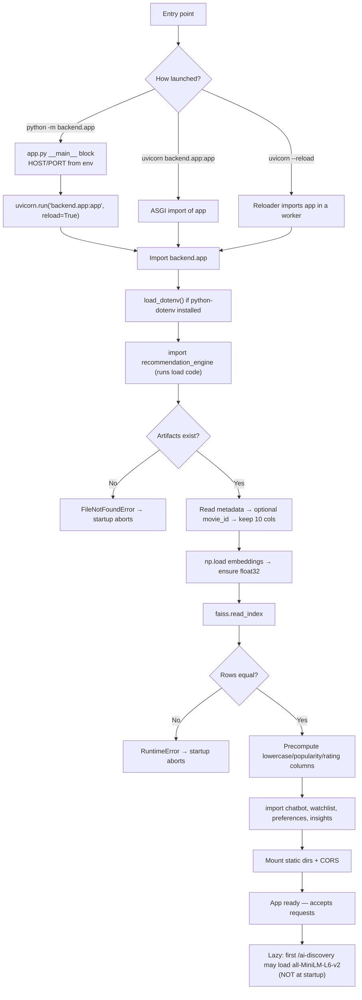

**Explanation**

- **Entry points (verified):** `backend/app.py:548–552` is the `__main__` guard;
  `uvicorn.run("backend.app:app", host=host, port=port, reload=True)`.
- **Config loading:** `python-dotenv` is imported optionally at `app.py:24–28`; if absent,
  environment variables must be exported manually. `HOST`/`PORT` come from the environment
  (defaults `127.0.0.1` / `8000`).
- **Dependency init:** `recommendation_engine` executes at import. The **Groq client is *not*
  created at startup** — it is created lazily by `llm.get_client()` on the first chatbot call.
- **Metadata loading / embedding / FAISS alignment:** all verified in
  `recommendation_engine.py:88–134`. The alignment check is real and hard-fails the process.
- ✅ **Embeddings are loaded from disk, not generated at startup.** Generation happens offline
  in `notebook/CineMind.ipynb` (`np.save`, `faiss.write_index`, `to_csv`).
- **Startup failures:**
  - Missing artifact file → `FileNotFoundError` from `_check_artifacts_exist()`.
  - Row-count mismatch → `RuntimeError` ("INDEX ALIGNMENT ERROR").
  - Port already in use → `uvicorn` raises `[Errno 10048]` on Windows; this is a **developer
    startup issue**, not an application runtime fallback (documented in Section 14).

---

## 5. Movie Recommendation Workflow

`POST /recommend` is the primary feature. This section traces it from the browser click to the
rendered cards.

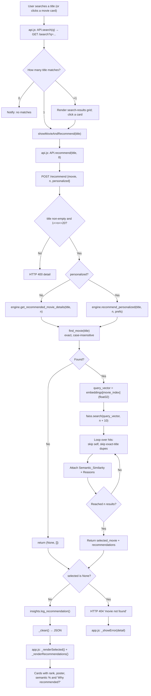

**Explanation**

- **Frontend entry:** `App.doSearch()` (`app.js:301`) calls `API.search()`. A single match goes
  straight to `showMovieAndRecommend(title)` (`app.js:341`), which calls `API.recommend(title, 8)`.
  Multi-match searches render a grid (`_renderSearchResults`), and clicking a card with
  `data-search-title` also calls `showMovieAndRecommend()`.
- **Validation:** `recommend()` (`app.py:276`) strips the title; empty → `HTTPException(400)`;
  `n` outside `1..20` → `HTTPException(400)`.
- **Dispatch:** `personalized=False` → `engine.get_recommended_movie_details(title, n)`;
  `personalized=True` → `engine.recommend_personalized(title, n, prefs_mod.get_preferences())`.
- **Query representation (verified):** a recommendation query uses the **saved embedding of the
  *seed movie*** (row `movie_index` of `movie_embeddings.npy`), not a freshly embedded string.
  This is why no Sentence Transformer is needed for `/recommend`.
- **FAISS search:** `loaded_faiss_index.search(query_vector, n + 10)` retrieves extra neighbours
  so the seed and any exact-title duplicates can be skipped (`recommendation_engine.py:216`).
- **Scoring:** each hit's score becomes `Semantic_Similarity = round(float(score), 4)`. Because
  the index is `IndexFlatIP` over **normalized** vectors, this score is cosine similarity.
- **Ranking:** plain recommendations follow FAISS order. `recommend_personalized()` instead
  computes `final_score = 0.5·semantic + 0.3·genre_match + 0.2·preference_match` and sorts by it
  (`recommendation_engine.py:499–510`).
- **Reasons:** `build_reasons()` (`recommendation_engine.py:347`) is purely deterministic — it
  compares genres, overview theme words, rating closeness, semantic score and (optionally) user
  preference genres. **No LLM is involved.**
- **Precomputed vs per-request:**
  - *Precomputed (once):* metadata, embeddings matrix, FAISS index, lowercase columns.
  - *Per-request:* `find_movie()` pandas filter, the FAISS `search()`, dedup/skip loop,
    `build_reasons()`, and `_clean()`.
- **Fallback path (verified):** if the seed title is not found, the engine returns
  `(None, [])` and the route raises `HTTP 404`; the frontend shows the error toast.

---

## 6. AI Discovery Workflow

AI Discovery (`POST /ai-discovery`) is **separate** from ordinary recommendations: it embeds a
free-text query (when possible) instead of reusing a seed movie's embedding.

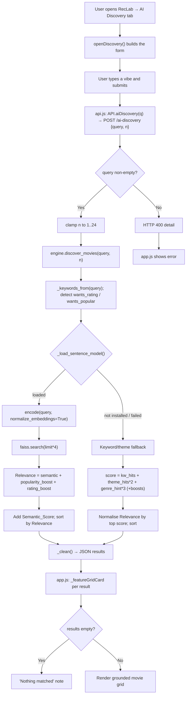

**Explanation**

- **Route (verified):** `ai_discovery()` (`app.py:532`) trims the query, raises `400` if empty,
  clamps `n` with `max(1, min(req.n, 24))`, calls `engine.discover_movies(query, n)`, logs the
  search and returns `{query, results}`.
- **Keyword pre-processing:** `_keywords_from()` tokenizes and drops stopwords
  (`recommendation_engine.py:649`). `wants_rating` and `wants_popular` are set when the query
  contains words like `best`/`rated` or `popular`/`trending`.
- **Decision node — model availability (`_load_sentence_model`, `recommendation_engine.py:614`):**
  - It lazily imports `sentence_transformers` and constructs `SentenceTransformer("all-MiniLM-L6-v2")`.
  - On success `_sent_available = True`; on **any** exception it sets `_sent_available = False`
    and prints a warning. A failed attempt is **not retried** (cached failure).
  - The first attempt is serialized by `_sent_model_lock` so concurrent requests do not each
    try to download/construct the model.
- **Semantic path (when the model loads):** the query is encoded with
  `normalize_embeddings=True`, searched in the **same** FAISS index, and each hit's
  `Relevance = semantic_score + popularity_boost + rating_boost`, with the raw cosine value kept
  in `Semantic_Score`.
- **Keyword fallback (when the model is unavailable):** for every movie row it scores
  `kw_hits + 2·theme_hits + 3·genre_hint_hits` (plus optional popularity/rating boosts), skips
  zero-score rows, sorts, and sets `Relevance` to `raw / top_raw`. It never returns
  `Semantic_Score` in this mode.
- ⚠️ **Environment fact:** in the inspected environment `sentence_transformers` is **not
  installed**, so AI Discovery currently takes the **keyword fallback** path. The semantic path
  is covered by a mocked unit test (`test_discovery_uses_semantic_path_when_model_available`).
- **Grounded only:** both strategies draw exclusively from `movie_metadata`; titles are never
  synthesized.
- ⚠️ **Minor code note:** `_rating_norm()` (`recommendation_engine.py:665`) is defined but never
  called anywhere; the discovery rating boost uses `_rating.iloc[idx] / 10.0` directly.

---

## 7. Chatbot Workflow

The chatbot is an **orchestration layer**: the local engine retrieves movies, and Groq only
*writes* the prose.

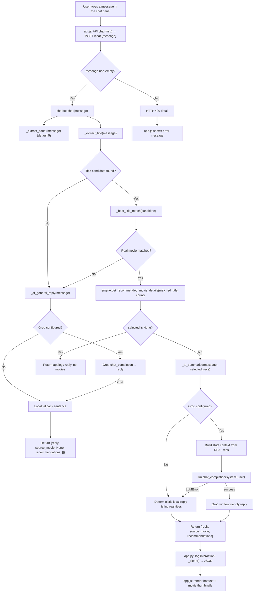

**Explanation**

- **Route (verified):** `chat()` (`app.py:323`) trims the message, raises `400` if empty, wraps
  `chatbot_module.chat(message)` in a `try/except` that converts unexpected exceptions to
  `HTTP 500`.
- **Intent extraction is local (verified):**
  - `_extract_count()` uses regex patterns that only treat a number as a *count* when tied to
    movie wording (e.g. "5 movies", "give me 3"), avoiding titles like "12 Angry Men". Default 5.
  - `_extract_title()` handles quoted titles, "like X" / "similar to X", and intent prefixes
    ("recommend X", "suggest X"), stripping trailing filler.
  - `_best_title_match()` resolves the candidate to a real title: exact match, then a
    punctuation-folded substring match (so "Avengers Endgame" matches "Avengers: Endgame"), then
    a plain substring.
- **Retrieval is 100% local:** the matched title is passed to
  `engine.get_recommended_movie_details(matched_title, count)` — the **same** function as
  `/recommend`. The LLM never decides which movies to return.
- **`_ai_summarize()` (`chatbot.py:197`):** builds a context string of real fields
  (title, year, rating, genres, similarity) and asks Groq to phrase a 2–4 sentence reply with a
  strict "only mention movies from the list" instruction. If Groq is not configured, or if
  `llm.chat_completion()` raises `llm.LLMError`, it returns a deterministic local sentence
  (`_local_reply`) that still names only the real results.
- **`_ai_general_reply()`:** handles greetings/questions when no movie is identified — Groq if
  configured, else a fixed fallback.
- **Configured Groq model (verified from source/config):** default is
  `openai/gpt-oss-120b` (`llm.py:50`), overridable by `GROQ_MODEL`. The API key is read from
  `GROQ_API_KEY` (legacy `AI_API_KEY` accepted; `AI_MODEL` as a model fallback). **No key value
  is ever printed or returned.**
- **Division of labour:**
  - *Local engine:* counting, title extraction/matching, candidate retrieval, ranking, reasons.
  - *Groq:* natural-language phrasing only.

---

## 8. Chatbot Request Sequence

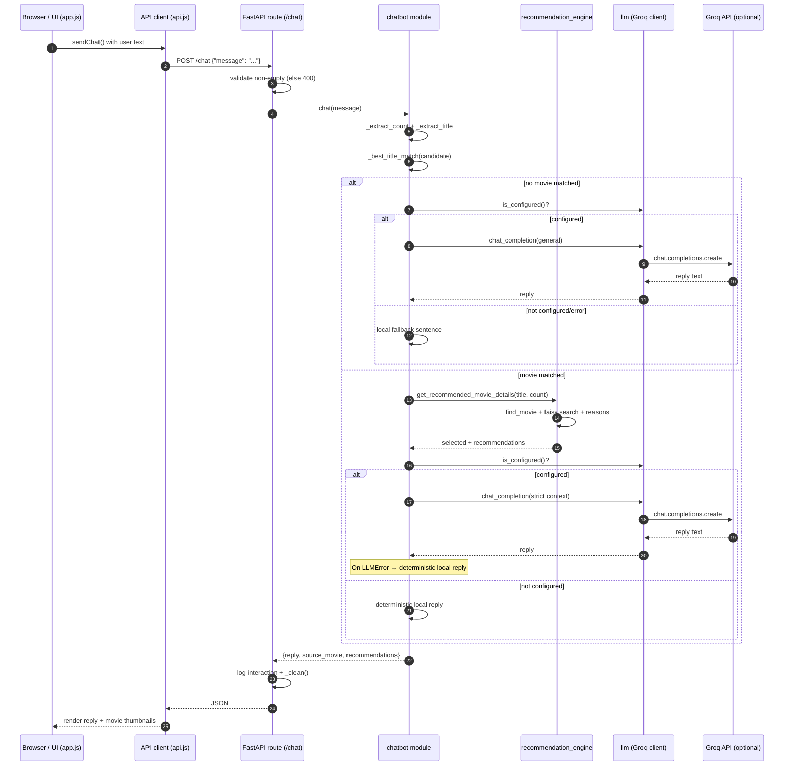

**Component interactions (verified):** Browser/UI (`app.js`) → API client (`api.js`) → FastAPI
route (`app.py` `/chat`) → chatbot module → recommendation engine (always) and Groq (only when
configured). No other components participate in this path.

---

## 9. Semantic Search and FAISS Workflow

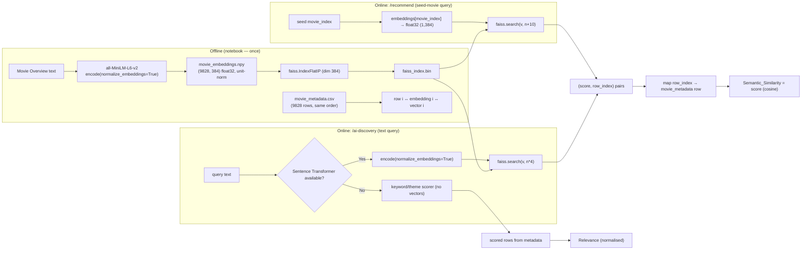

**Explanation (all values verified against the files on disk)**

- **Embedding representation:** `models/movie_embeddings.npy` is a `float32` array of shape
  `(9828, 384)`. A sampled row has L2 norm `1.0`, confirming the embeddings are **normalized**.
- **Vector dimension:** 384 (the output size of `all-MiniLM-L6-v2`). Confirmed by
  `embeddings.shape[1]` and by the FAISS index dimension (`index.d == 384`).
- **FAISS index type:** `faiss.IndexFlatIP` — a flat (exhaustive) index using **inner product**.
  Confirmed by `type(index).__name__ == "IndexFlatIP"` and `metric_type == 0` (IP).
- **Similarity metric:** because vectors are unit-normalized, inner product **equals** cosine
  similarity. So `Semantic_Similarity` is a cosine score in roughly `[-1, 1]` (in practice
  `[0, 1]` for this data), where higher = more similar.
- **Normalization:** done offline in the notebook (`normalize_embeddings=True`). At query time,
  `/recommend` reuses already-normalized saved vectors; `/ai-discovery` re-encodes with
  `normalize_embeddings=True` so its query vector lives in the same space.
- **Query → vector:**
  - `/recommend`: `np.asarray(loaded_movie_embeddings[movie_index], dtype="float32").reshape(1, -1)`.
  - `/ai-discovery`: `_sent_model.encode([q], normalize_embeddings=True).astype("float32")`.
- **Nearest neighbours → results:** `search()` returns parallel `(scores, indices)` arrays. A
  returned `index` is a **row position** into both the metadata DataFrame and the embedding
  matrix (guaranteed by the startup alignment check), so it maps directly to a movie row.
- **Cosine vs inner product:** the implementation relies on the normalization invariant; there is
  **no** separate cosine-normalization step at query time. This equivalence is stated explicitly
  in the code comments (`recommendation_engine.py:191–196`) and the notebook.
- **Edge cases:** FAISS can return `-1` for missing slots; the loops skip any
  `idx < 0 or idx >= len(movie_metadata)`.

---

## 10. Result Generation and Display Workflow

This section follows one raw FAISS hit to a visible card. **There is no extra reranking stage
beyond what is shown here** — `/recommend` uses FAISS order; personalized/What-If use their own
computed scores (documented in their sections).

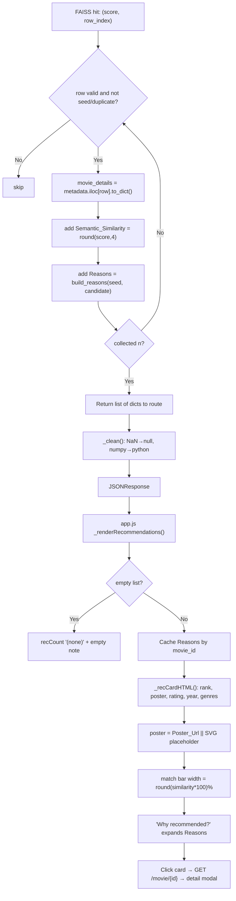

**Explanation (verified)**

- **Serialization:** `app._clean()` (`app.py:122`) recursively converts NaN → `None` and numpy
  scalars → Python types so FastAPI can emit valid JSON. This is why the frontend never has to
  handle `NaN`.
- **Metadata lookup / posters:** each result is a full metadata row, so `Poster_Url` travels with
  it. `Utils.poster()` returns `''` for missing values; `Utils.placeholder(title)` builds an
  inline SVG data-URI fallback, and every `` also has an `onerror` fallback.
- **Ranking shown to the user:** `_recCardHTML()` (`app.js:411`) numbers cards by position
  (rank 1 is marked "TOP MATCH") and renders the semantic similarity as a percentage bar via
  `Utils.simPercent()`.
- **"Why recommended?":** `_whyBlock()` renders `Reasons.reasons`; the modal additionally shows
  `Reasons.factors.semantic` and shared genres (`app.js:516–528`).
- **Filters (verified):** the only filtering in the recommendation path is *skip the seed* and
  *skip exact-title duplicates*. Genre/language/vote filters exist **only** on `GET /movies`.
- **Empty results / errors:** `_renderRecommendations()` prints "No similar movies found." for an
  empty list; network/HTTP errors surface via `_showError()` using the backend `detail`.
- **Detail modal:** clicking a card calls `GET /movie/{movie_id}` (`openMovieDetails`) and renders
  rating, release date, genres, language, popularity, movie id, plus the Why-Recommended block.

---

## 11. Persistent Storage Workflow

All persistence is plain JSON under `data/`, through `backend/storage.py`. Three files are used:
`watchlist.json`, `user_preferences.json`, `recommendation_history.json`.

### 11.1 Write workflow (e.g. add to watchlist)

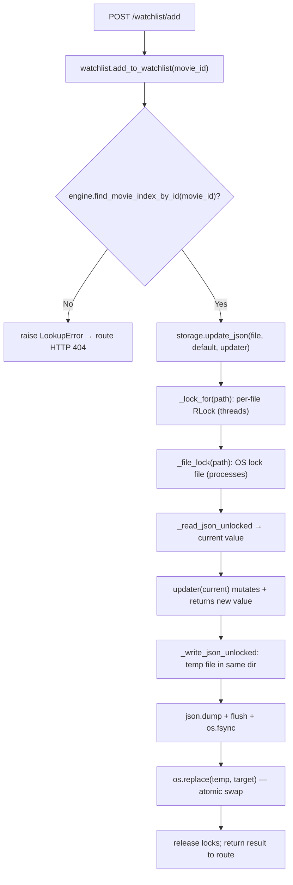

### 11.2 Read workflow (e.g. get watchlist)

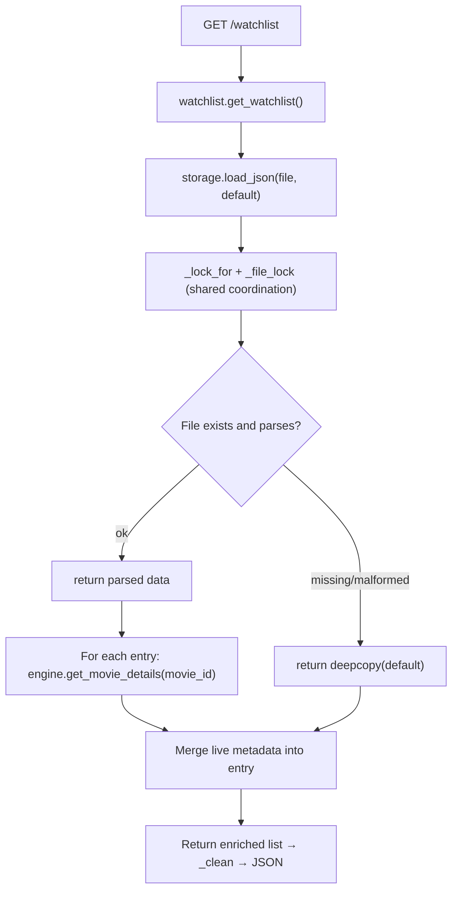

**Explanation (verified)**

- **Two-level locking:** `_lock_for()` gives every JSON path a `threading.RLock` (in-process
  threads); `_file_lock()` acquires an **OS-level lock** on a sibling `.lock` file
  (`msvcrt.locking` on Windows, `fcntl.flock` elsewhere) for **cross-process** safety.
- **Atomic replacement:** `_write_json_unlocked()` writes to a `NamedTemporaryFile` in the same
  directory, `flush()`es, `os.fsync()`es, then calls `os.replace()` (atomic on the same volume),
  and cleans up the temp file in a `finally`.
- **Read-modify-write is the real protection:** atomic replacement alone would *not* prevent lost
  updates. `update_json()` holds **both** the thread lock and the file lock across the entire
  read → mutate → write sequence, which is what prevents concurrent writers from clobbering each
  other. This is directly tested by
  `test_read_modify_write_does_not_lose_cross_process_updates` (4 processes × 20 increments).
- **Malformed files are tolerated:** `load_json()`/`_read_json_unlocked()` catch
  `JSONDecodeError`/`OSError`/`ValueError` and return the default instead of crashing a request.
- **History is best-effort:** `insights.log_event()` swallows all exceptions and caps the log at
  `MAX_ENTRIES = 500`, so activity logging never breaks a request.
- **Enrichment on read:** the watchlist file stores only `{movie_id, title, added_at}`; posters
  and genres are joined from `movie_metadata.csv` at read time, keeping the file small and the
  dataset authoritative.
- **Preferences derivation:** `preferences.add_feedback()` removes the movie from the opposite
  list, then `_recompute_tags()` re-derives `preferred_genres`/`preferred_themes` (and
  `favorite_genres`) from the liked movies' real metadata — no ML retraining.

---

## 12. API and Frontend Communication

All routes are defined in `backend/app.py`. Every route is listed below exactly as implemented;
none are invented.

| Method | Path | Request body / query | Response | Validation & errors | Frontend caller |
|---|---|---|---|---|---|
| GET | `/` | — | `index.html` or info JSON | — | browser navigation |
| GET | `/api` | — | `{app,status,movies_indexed,embedding_dim,endpoints}` | — | `API.apiInfo()` → `_loadStats()` |
| GET | `/movies` | `limit` (≤200), `sort_by`, `genre`, `lang`, `not_lang`, `min_votes` | `{results: [...]}` | limit clamped `1..200`; empty filters → `{results: []}` | `API.movies()` → `_loadHomeRows()`, genre/for-you rows |
| GET | `/search` | `q` (required) | `{query, results}` | empty `q` → `400` | `API.search()` → `doSearch()` |
| POST | `/recommend` | `{movie, n=5, personalized=false}` | `{selected_movie, recommendations, personalized}` | empty movie → `400`; `n∉[1,20]` → `400`; not found → `404` | `API.recommend()` → `showMovieAndRecommend()` |
| GET | `/movie/{movie_id}` | path id | movie dict | not found → `404` | `API.movieDetails()` → `openMovieDetails()`, `_resolveTitles()` |
| POST | `/chat` | `{message}` | `{reply, source_movie, recommendations}` | empty → `400`; unexpected → `500` | `API.chat()` → `sendChat()` |
| GET | `/watchlist` | — | `{results, count}` | — | `API.watchlist()` → `openWatchlist()` |
| POST | `/watchlist/add` | `{movie_id}` | `{movie_id, title, added_at, added}` | not found → `404` | `API.watchlistAdd()` → `toggleWatchlist()` |
| DELETE | `/watchlist/remove/{movie_id}` | path id | `{removed, movie_id, in_watchlist:false}` | — | `API.watchlistRemove()` |
| GET | `/watchlist/check/{movie_id}` | path id | `{movie_id, in_watchlist}` | — | `API.watchlistCheck()` → `_readWatchlistState()` |
| GET | `/preferences` | — | preferences + derived stats | — | `API.preferences()` → `openPreferences()`, `_loadForYouRow()` |
| POST | `/preferences/feedback` | `{movie_id, action}` | `{ok, action, preferences}` | bad action → `400`; not found → `404` | `API.feedback()` → `sendFeedback()` |
| POST | `/preferences/reset` | — | `{ok, preferences}` | — | `API.prefsReset()` |
| GET | `/insights` | — | aggregated stats | — | `API.insights()` → `openInsights()`, `openHistory()` |
| POST | `/compare` | `{movies: [...]}` | `{results: [...]}` | `<2` or `>3` → `400`; not found → `404` | `API.compare()` → `openCompare()` |
| POST | `/what-if` | `{movie, n, action…seriousness, phrase?}` | `{selected_movie, weights, recommendations}` | `n∉[1,20]` → `400`; no seed → `400`; not found → `404` | `API.whatIf()` → `openWhatIf()` |
| POST | `/ai-discovery` | `{query, n=12}` | `{query, results}` | empty → `400`; `n` clamped `1..24` | `API.aiDiscovery()` → `openDiscovery()` |

**Pydantic request models (verified in `app.py`):** `RecommendRequest`, `ChatRequest`,
`WatchlistAddRequest`, `FeedbackRequest`, `CompareRequest`, `WhatIfRequest`, `AIDiscoveryRequest`.
Numeric ids are accepted as `str | int` for watchlist/feedback (`movie_id: str | int`).

**Base-URL resolution (`api.js:15`):** the client first tries `GET /api` same-origin and only
trusts it if it returns `application/json`; otherwise it falls back to
`http://127.0.0.1:8000`. A static preview (IDE Live Server) thus still reaches a locally running
backend.

**Error surfacing:** `_fetch()` throws with the backend's `detail` when present; `app.js`
displays it via `_showError()` or inline error boxes.

---

## 13. Data and Model Artifacts

| Artifact | Location | Verified properties |
|---|---|---|
| Movie metadata | `models/movie_metadata.csv` | **9,828 rows × 10 columns**; columns: `movie_id, Title, Release_Date, Overview, Popularity, Vote_Count, Vote_Average, Original_Language, Genre, Poster_Url` |
| Embeddings | `models/movie_embeddings.npy` | `float32`, shape **(9828, 384)**; rows unit-normalized (sampled norm = 1.0) |
| FAISS index | `models/faiss_index.bin` | `IndexFlatIP`, `ntotal = 9828`, dimension `384`, metric = inner product |

**Relationships (verified):**

- Row `i` of `movie_metadata.csv`, row `i` of `movie_embeddings.npy`, and vector `i` of the FAISS
  index all describe the **same movie**. This invariant is enforced at startup (Section 4).
- `movie_id` is the join key used by `/movie/{id}`, the watchlist, and preferences. If the CSV
  lacks a `movie_id` column, the engine synthesizes one from the DataFrame index — which keeps it
  aligned with the artifacts, but means ids are positional in that case.
- `Title` is lower-cased/stripped for searching (`find_movie`, `search_movies`).
- `Overview` + `Genre` feed `build_reasons()` and the AI-Discovery fallback scoring.
- `Poster_Url` is a full URL returned to the browser; missing values fall back to an SVG.

**Offline vs online (verified):**

| Stage | When | Where |
|---|---|---|
| Embedding generation (`normalize_embeddings=True`, `np.save`) | Offline, once | `notebook/CineMind.ipynb` |
| FAISS index build (`IndexFlatIP`, `faiss.write_index`) | Offline, once | `notebook/CineMind.ipynb` |
| Metadata export (`to_csv`) | Offline, once | `notebook/CineMind.ipynb` |
| Load `.npy` / `.bin` / `.csv` | Startup, once per process | `backend/recommendation_engine.py` |
| FAISS `search()` and result shaping | Every `/recommend`, `/ai-discovery`, What-If, compare | `backend/recommendation_engine.py` |

> The `.npy`, `.bin`, and `.csv` files are listed in `.gitignore` and are expected to be placed
> in `models/` manually (or produced by the notebook).

---

## 14. Error Handling and Fallback Workflows

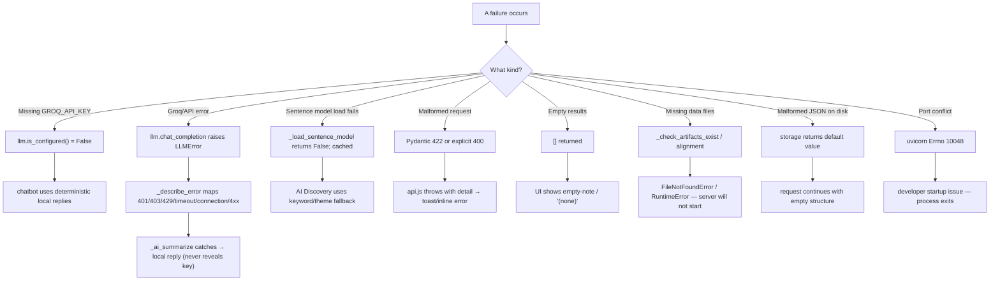

**Explanation — runtime fallbacks vs startup issues**

*Application runtime fallbacks (handled gracefully):*

- **Missing API key:** `llm.is_configured()` is `False`; the chatbot returns deterministic local
  replies (`_local_reply` / general fallback). A warning is printed once at import.
- **Groq errors:** `llm.chat_completion()` wraps SDK exceptions into `LLMUnavailable` with a safe
  message (401/403/429/timeout/connection/invalid-model). The chatbot catches `LLMError` and
  falls back to the local reply. ✅ Tests assert the key never appears in the message.
- **Sentence-model load failure:** cached `False`; AI Discovery uses the keyword scorer. If the
  `sentence_transformers` package is simply not installed (the case in this environment), the
  same fallback applies.
- **Malformed request / validation:** FastAPI returns `422` for schema errors; handlers raise
  explicit `400`/`404`; the frontend shows the `detail`.
- **Empty results:** routes return empty arrays; the UI shows the appropriate empty note.
- **Malformed persisted JSON:** `storage` returns the default and the request proceeds.

*Developer / startup issues (not runtime fallbacks):*

- **Missing model artifacts:** `FileNotFoundError` at import — the server will not start.
- **Row-count mismatch:** `RuntimeError` ("INDEX ALIGNMENT ERROR") at import.
- **Port already in use:** `uvicorn` raises `[Errno 10048]` on Windows; the developer must free the
  port or change `PORT`. This is not caught by application code.

⚠️ **Not implemented / not verified:** there is no retry/backoff around Groq calls and no
circuit breaker. Groq failures always fall straight to the local reply. There is no automatic
re-download of the Sentence Transformer model after a failed load (the failure is cached for the
process lifetime).

---

## 15. Tests and Verification

Tests live in `tests/` and use `unittest` with mocks only — no network, no real API key.

| Test file | What it covers |
|---|---|
| `tests/test_chatbot_groq.py` | Groq provider config (`get_model`, `get_api_key`, `get_timeout`, `provider_status` key-safety); client lifecycle (create-once, reset, base-url, missing SDK); `chat_completion` success and error mapping (401/429/timeout/connection/invalid-model/key-leak); chatbot fallbacks (`_ai_summarize`, `_ai_general_reply`, `chat` uses local engine + Groq only for wording, never invents movies). |
| `tests/test_targeted_fixes.py` | Sentence-model lazy loading (loads once, caches failure, concurrent first-load attempted once); AI Discovery semantic vs keyword paths; Groq provider construction; `storage` atomic-write temp cleanup and cross-process read-modify-write safety (4 subprocesses × 20 increments). |

**Verified test command and result (run in this environment):**

```powershell
.venv\Scripts\python.exe -m unittest discover -s tests -v
```

Result:

```
Ran 39 tests in 1.344s

OK
```

All **39 tests passed**. Environment: Python **3.13.15**, fastapi **0.141.1**, groq **1.7.0**,
faiss **1.15.0**, numpy **2.5.3**, pandas **2.2.3**. `sentence_transformers` is **not installed**
here, so the real (non-mocked) AI-Discovery path at runtime is the keyword fallback.

> The tests do not exercise the live FastAPI HTTP layer end-to-end; they test the modules
> directly. Live routes were reviewed by reading `backend/app.py` rather than by HTTP testing.

---

## 16. How to Trace a Request in Source Code

Use this as a map when debugging. Each row gives the browser action, the frontend function, the
route, and the backend function(s).

| User action | Frontend (start →) | Route | Backend chain |
|---|---|---|---|
| Search a title | `doSearch()` (`app.js:301`) → `API.search()` | `GET /search` | `app.search_movies()` (`app.py:261`) → `engine.search_movies()` |
| Pick a movie → recommendations | `showMovieAndRecommend()` (`app.js:341`) → `API.recommend()` | `POST /recommend` | `app.recommend()` (`app.py:275`) → `engine.get_recommended_movie_details()` (or `recommend_personalized`) → `build_reasons()` |
| Open a movie card | `openMovieDetails()` (`app.js:483`) → `API.movieDetails()` | `GET /movie/{id}` | `app.movie_details()` (`app.py:309`) → `engine.get_movie_details()` |
| Load home rows | `_loadHomeRows()` (`app.js:1145`) → `API.movies()` | `GET /movies` | `app.list_movies()` (`app.py:184`) |
| Chat | `sendChat()` (`app.js:1122`) → `API.chat()` | `POST /chat` | `app.chat()` (`app.py:323`) → `chatbot.chat()` → `engine.get_recommended_movie_details()` → `llm.chat_completion()` |
| AI Discovery | `openDiscovery()` (`app.js:954`) → `API.aiDiscovery()` | `POST /ai-discovery` | `app.ai_discovery()` (`app.py:532`) → `engine.discover_movies()` → `_load_sentence_model()` |
| What-If | `openWhatIf()` (`app.js:988`) → `API.whatIf()` | `POST /what-if` | `app.what_if()` (`app.py:487`) → `chatbot.parse_whatif_phrase()` → `engine.what_if_recommendations()` |
| Compare | `openCompare()` (`app.js:648`) → `API.compare()` | `POST /compare` | `app.compare()` (`app.py:440`) → `engine.find_movie_index_by_id()` / `_pairwise_similarity()` |
| Toggle watchlist | `toggleWatchlist()` (`app.js:571`) → `API.watchlistAdd/Remove()` | `POST /watchlist/add`, `DELETE /watchlist/remove/{id}` | `watchlist.add_to_watchlist()` / `remove_from_watchlist()` → `storage.update_json()` |
| Like / dislike | `sendFeedback()` (`app.js:591`) → `API.feedback()` | `POST /preferences/feedback` | `preferences.add_feedback()` → `_recompute_tags()` → `storage.update_json()` |
| Preferences panel | `openPreferences()` (`app.js:819`) → `API.preferences()` | `GET /preferences` | `preferences.get_preferences()` |
| Insights / history | `openInsights()` / `openHistory()` → `API.insights()` | `GET /insights` | `insights.get_insights()` |

**Fastest way to trace a bug end-to-end:**

1. Find the `API.*` call in `frontend/js/app.js` for the feature.
2. Jump to the matching method in `frontend/js/api.js` to see the exact path + payload.
3. Find the route decorator in `backend/app.py`.
4. Follow the delegated call into `backend/recommendation_engine.py`, `backend/chatbot.py`,
   `backend/llm.py`, or the persistence modules.
5. Check `_clean()` and the Pydantic model for how the response is shaped.

### Quick reference — modules and responsibilities

- `backend/app.py` — HTTP surface + JSON cleaning; no ML logic.
- `backend/recommendation_engine.py` — the model: artifacts, FAISS, ranking, discovery, reasons.
- `backend/chatbot.py` — intent parsing + orchestration (local retrieval, optional Groq prose).
- `backend/llm.py` — the only external AI integration point.
- `backend/{watchlist,preferences,insights}.py` — user-state features.
- `backend/storage.py` — atomic, locked JSON I/O.
- `frontend/js/{api,app,utils,notifications}.js` — client, controller/renderer, helpers, toasts.

---

*This document was produced by inspecting the repository at commit `cee7bd7` plus the
uncommitted working-tree changes present at the time of writing (modified `backend/*.py`,
`README.md`, `requirements.txt`, `.env.example`; untracked `backend/llm.py`, `tests/`, and this
file). It does not modify any source, artifact, dataset, `.env`, or dependency. See
[`README.md`](README.md) for navigation and setup.*
